# Temper ZMK Config

This is my personal ZMK config for the [temper](https://github.com/raeedcho/temper).

Some notes about this config:
- Four layers: Base, Extra, System, and Mouse
- Base is QWERTY, with Ctrl/A, Shift/Z, Ctrl/semicolon, and Shift/slash mod-taps; the left Ctrl thumb is a plain modifier
- Mod-taps use balanced flavor and a 180 ms tapping term, with prior-idle and quick-tap forcing disabled (tune `&mt` in `boards/shields/temper/temper.keymap`)
- Base GUI thumb: tap or hold for GUI; double-tap within 200 ms for GUI+Tab
- Base right Alt thumb: tap or hold for right Alt (AltGr); double-tap within 200 ms for left Alt+Tab
- Hold the middle right thumb for Extra: numbers, arrows, parentheses on U/I, and square brackets on M/comma
- On Extra, tap the semicolon position for apostrophe or hold it for System; Extra's 1–5 select Bluetooth profiles 0–4, and 0 clears the current profile
- Extra's Y position sends tilde; the Space thumb sends GUI+Space
- Extra's Tab position: tap for Tab, hold for Mouse
- Mouse: P = PrintScreen, H/J/K/L = cursor left/down/up/right, M/comma = scroll down/up,
  U/I = volume up/down, right thumbs = Mouse 1/2/3 (left/right/middle click)
- Once holding Mouse's layer key, release the Extra thumb to reuse it as Mouse 2;
  keep holding the layer key to remain on Mouse
- Both halves enter deep sleep after 15 minutes of inactivity (`config/temper.conf`)
- The key matrix is a wake source: press a key on each sleeping half to wake it,
  then allow Bluetooth to reconnect. The waking keypress may not reach the host.
- Unassigned keys are disabled; transparent Extra keys retain their Base bindings

After flashing keymap changes, use **Restore Stock Settings** in ZMK Studio if a saved
Studio keymap is overriding them. This discards Studio keymap edits.

Enabling mouse support changes the HID descriptor. For Bluetooth, forget the keyboard
on the host, clear that host's Bluetooth profile on the keyboard, then pair again.
USB refreshes the descriptor on reconnect.



## Local builds

Requires `just`, `uv`, Git, CMake, Ninja, and GNU Arm Embedded GCC installed under
`/usr` (the setup recipe installs Python dependencies, not system packages).

```sh
just setup        # Download the ZMK version pinned in config/west.yml
just build        # Build both halves
just build-left   # Or build one half
just build-right
just test         # Display logic tests
just draw         # Regenerate the keymap diagram
just clean        # Remove firmware/build outputs, retain dependencies
```

Flash `build/temper-left.uf2` and `build/temper-right.uf2` to their respective halves.
The left build includes ZMK Studio. Dependencies are stored in `.build/west`; both
`.build/` and `build/` are ignored by Git. Run `just setup` again after updating the
firmware pin; use `just clean` before switching workspaces or toolchains.

Override `ZMK_WORKSPACE` with an absolute workspace path if needed. For the Zephyr
SDK instead of GNU Arm, set `ZEPHYR_TOOLCHAIN_VARIANT=zephyr` and
`ZEPHYR_SDK_INSTALL_DIR` to the SDK installation. For GNU Arm installed elsewhere,
set `GNUARMEMB_TOOLCHAIN_PATH` to its installation root.

## Custom nice!view screens

The local `display/` module provides portrait screens for ZMK v0.3.0:

- **Left:** local battery percentage and active USB/BT output at the top, a typing-driven
  three-pose cat in the middle, and Bluetooth profile number (1–5) on the left of the
  active layer name at the bottom. Profiles are displayed as 1–5 (internal indices
  remain 0–4). The profile remains visible when USB is active.
- **Right:** local battery percentage and split connection (`LINK` connected, `----`
  disconnected) at the top, with an original cat/split-keyboard logo underneath.
- Key presses from either half animate the left cat at up to 10 frames per second.
  It returns to rest after 220 ms without a press, then pauses its animation timer.
  Holding a key does not continuously animate it.

Customize layout and event handling in `display/screen.c`, artwork in `display/art.c`,
or animation timing/portrait rotation in `display/portrait.h`. Portrait content is
rotated clockwise onto the native 160 × 68 panel. If physically upside-down, reverse
that mapping in `portrait_native_index()`.

Each half's `.conf` disables the stock nice!view widget to avoid duplicate screens.
The module is registered by `zephyr/module.yml`; no external display dependency is
needed. Rebuild and flash both halves to install the screens. Idle/sleep settings
are unchanged by the display module.

Run the dependency-free rotation/animation tests:

```sh
cc -std=c99 -Wall -Wextra -Werror tests/display_test.c -o /tmp/temper-display-test
/tmp/temper-display-test
```
